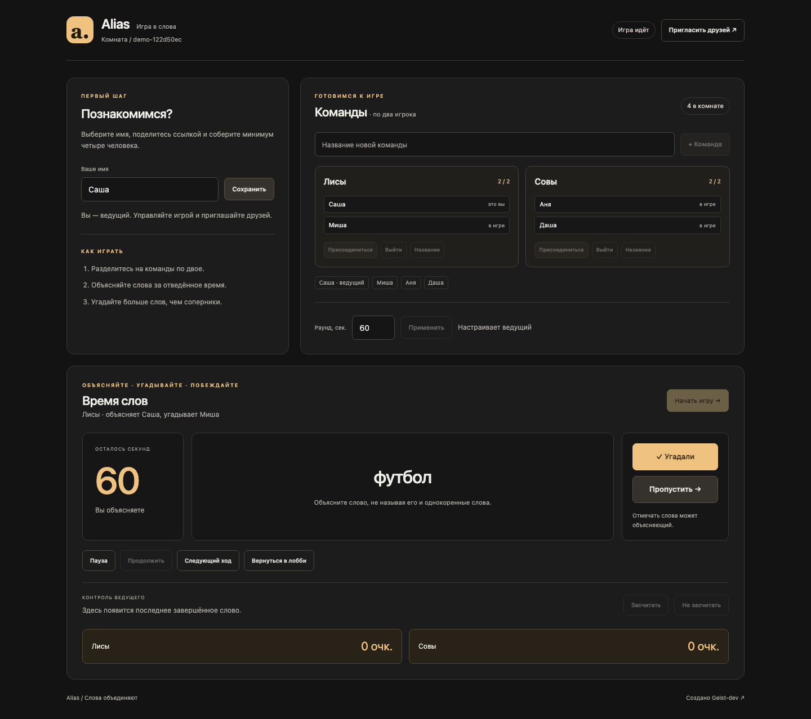
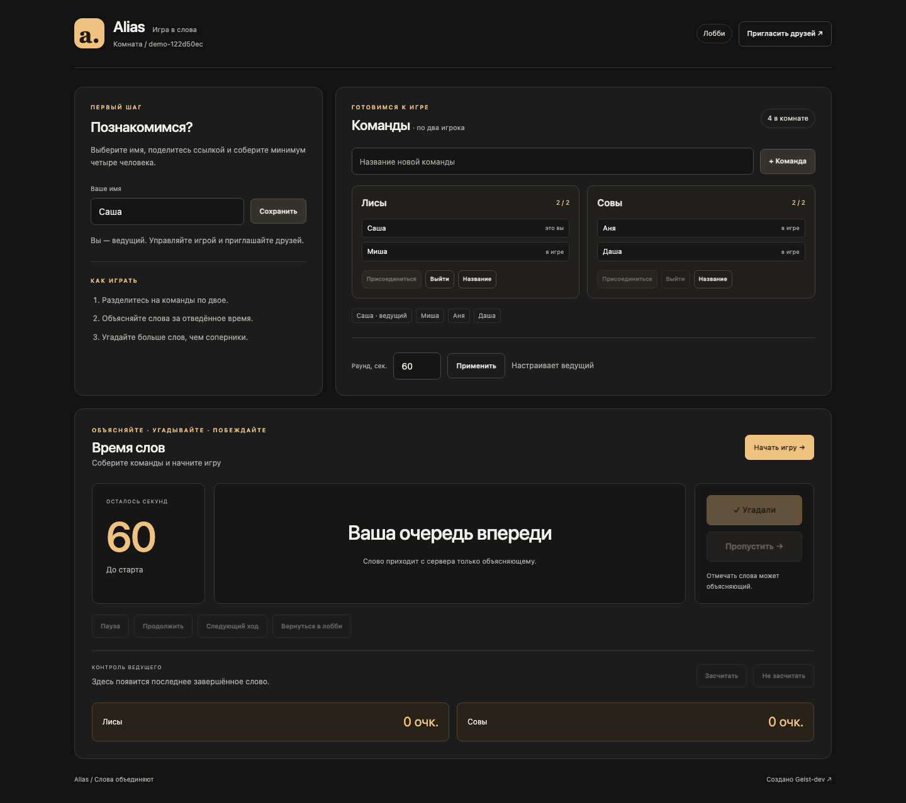
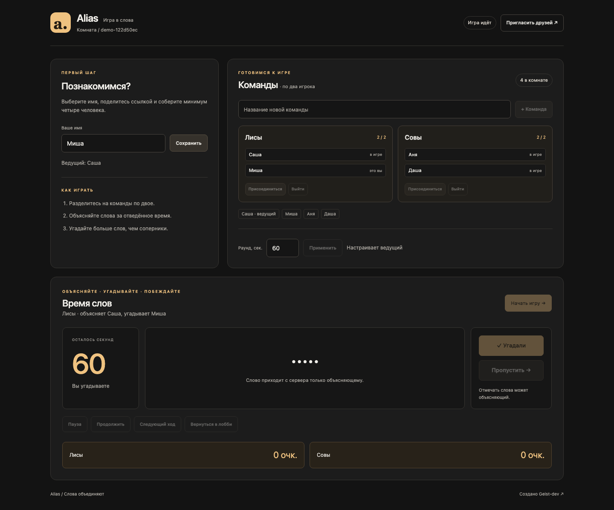
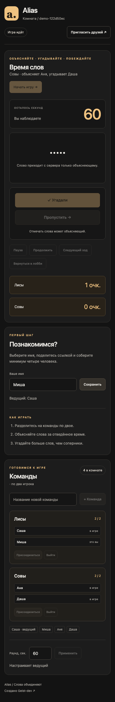

<div align="center">

# Alias

**Объясняйте слова. Собирайте команды. Играйте вместе.**

Браузерный мультиплеер · Комнаты по ссылке · Синхронизация через WebSocket

[](https://nodejs.org/)
[](https://github.com/Geist-dev/Alias/actions/workflows/tests.yml)
[](LICENSE)

[Запуск одной командой](#быстрый-запуск) · [Пошаговый запуск](#пошаговый-запуск) · [Правила](#как-играть) · [Скриншоты](#скриншоты)

</div>



## Что это

Alias — небольшая командная игра в слова. Игроки заходят в одну комнату по ссылке и объединяются в пары. Один объясняет слово, второй угадывает; сервер ведёт время, очки и порядок ходов.

Интерфейс работает без сборки: Vanilla JavaScript, HTML и CSS. Один процесс Node.js обслуживает страницу и WebSocket. Для локальной игры не нужны Discord-токены, API-ключи или платные сервисы.

## Возможности

- Комнаты по отдельным ссылкам, имена игроков и команды по двое.
- Минимум **4 игрока**: две полные команды. Остальные могут наблюдать.
- Раунд от 20 до 180 секунд, чередование команд и объясняющих.
- Слово и его идентификатор отправляются **только текущему объясняющему**. Угадывающий и зрители не получают их даже в сетевом состоянии.
- Очки за угаданные слова, пропуск, пауза и следующий ход.
- Коррекция последнего завершённого слова ведущим без повторного начисления очков.
- Проверки действий на сервере: права ведущего, состав команд, повторные нажатия.
- Возврат в лобби для изменения команд.
- Сохранение места при переподключении в течение 30 секунд.
- Передача роли ведущего подключённому игроку при потере связи.
- Адаптивный интерфейс для компьютера и телефона.

## Требования

- **Node.js 22.9+ в ветке 22 или Node.js 24**, включая npm.
- Git для клонирования.
- Интернет при установке зависимостей. После установки локальный сервер работает без внешних API.
- Bash: macOS, Linux или Git Bash на Windows. Для PowerShell есть инструкция ниже.

## Быстрый запуск

Для нового проекта — одна команда в терминале:

```bash
git clone https://github.com/Geist-dev/Alias.git && cd Alias && bash start.sh
```

В уже скачанном проекте:

```bash
bash start.sh
```

Скрипт проверяет Node.js, устанавливает зависимости строго по `package-lock.json` через `npm ci` и запускает сервер. Глобальные npm-пакеты не меняются. По умолчанию `.env` не нужен.

Откройте **http://127.0.0.1:3000**. Страница создаст ID комнаты и добавит его к адресу. Нажмите **«Пригласить друзей»**, чтобы скопировать ссылку. Для остановки — **Ctrl+C**.

## Пошаговый запуск

**1. Скачайте проект.**

```bash
git clone https://github.com/Geist-dev/Alias.git
cd Alias
```

**2. Проверьте установленную версию Node.js.**

```bash
node --version
npm --version
```

Используйте Node.js 22.9+ или 24.

**3. Установите зависимости.**

```bash
npm ci
```

**4. При необходимости настройте адрес и порт.** Для стандартного локального запуска этот шаг можно пропустить.

macOS / Linux / Git Bash:

```bash
cp .env.example .env
```

Windows PowerShell:

```powershell
Copy-Item .env.example .env
```

Откройте `.env` в редакторе. В нём можно задать:

```dotenv
HOST=127.0.0.1
PORT=3000
```

**5. Запустите приложение.**

```bash
npm start
```

**6. Откройте http://127.0.0.1:3000.** Для локальной проверки создайте **четыре независимые вкладки или браузерных профиля** с одной ссылкой комнаты. В каждой задайте имя, создайте две команды, распределите игроков и нажмите «Начать игру».

PowerShell использует те же команды `npm ci` и `npm start`; Bash не требуется. Остановка — Ctrl+C.

## Как играть

1. Первый подключившийся становится **ведущим**.
2. Укажите имя и пригласите остальных по ссылке комнаты.
3. Создайте две или больше команд, по два подключённых игрока в каждой.
4. Ведущий выбирает длительность раунда и запускает игру.
5. Объясняющий видит слово и нажимает **«Угадали»** или **«Пропустить»**. За угаданное слово команда получает одно очко; за пропуск штрафа нет.
6. По окончании времени ход переходит следующей полной команде. При следующем ходе той же команды игроки меняются ролями.
7. Ведущий может поставить игру на паузу, перейти к следующему ходу или исправить результат последнего завершённого слова.
8. Чтобы изменить команды, нажмите **«Вернуться в лобби»**. Новый старт сбрасывает счёт. Автоматического финала или порога победы пока нет — длительность партии определяют игроки.

Обсуждать слова можно вживую или в отдельном голосовом чате. Само приложение не передаёт звук.

## Скриншоты

Настоящие снимки работающего приложения с четырьмя независимыми браузерными клиентами.

| Лобби | Экран угадывающего |
| --- | --- |
|  |  |

<details>
<summary>Мобильный интерфейс</summary>



</details>

## Переподключение и состояние

Игра хранится **в памяти одного процесса**. Перезапуск сервера очищает комнаты и счёт.

В текущей вкладке браузер хранит персональный токен переподключения в `sessionStorage`. Он передаётся только в первом WebSocket-сообщении, не попадает в ссылку комнаты или состояния других игроков. Обновление страницы в течение 30 секунд сохраняет имя и место в команде.

Если объясняющий или угадывающий отключился, игра приостанавливается. После возврата ведущий может продолжить её. Если игрок не вернулся за 30 секунд, комната возвращается в лобби для пересборки команд. Пустая комната удаляется через 60 секунд.

Если дублировать вкладку вместе с её `sessionStorage`, обе копии имеют одну игровую сессию: новая отключит прежнюю. Для разных игроков открывайте ссылку в независимых вкладках/профилях.

## Архитектура

```text
Четыре браузера
      │ HTTP + WebSocket
      ▼
Node.js / Express / ws
      ├── src/game.js — правила, таймер, очки и проверка действий
      ├── отдельное состояние для каждого получателя
      ├── комнаты и сессии в памяти
      └── data/words_ru.txt — словарь
```

```text
server.js            HTTP, WebSocket, сессии и жизненный цикл комнат
src/game.js          игровая логика и формирование безопасного ответа
public/              интерфейс без сборки
data/words_ru.txt    словарь вне публичной папки
start.sh             проверка окружения, установка и запуск
tests/               игровые, сетевые и браузерные проверки
docs/screenshots/    реальные снимки приложения
```

Имена игроков и команд выводятся через `textContent`, без интерпретации HTML. Сервер не доверяет доступности кнопок в интерфейсе и отдельно проверяет каждую команду. Повторная отметка уже сменившегося слова не начисляет очки.

## Проверки

Из корня проекта после `npm ci`:

```bash
npm test
npm run check
```

Проверяются скрытие слова на уровне сетевого ответа, права ведущего, заполненность команд, неизменность состава во время игры, повторные нажатия, коррекция счёта, время паузы, чередование ролей, переподключение, некорректные сообщения и ограничение размера WebSocket-пакета.

Для настоящего браузера дополнительно нужен Python с Playwright. Это инструменты разработки; для обычного запуска игры Python не нужен.

```bash
python -m pip install playwright
python -m playwright install chromium
```

Запустите приложение, затем в другом терминале:

```bash
python tests/browser_smoke.py
```

Сценарий открывает четыре независимых клиента, проверяет игру, приватность сетевых пакетов, очки, паузу, смену хода, перезагрузку, безопасный вывод имён и мобильную ширину. Он использует новую временную комнату. Для обновления снимков: `python tests/browser_smoke.py --screenshots`. Другой адрес можно передать первым аргументом.

GitHub Actions запускает игровые и сетевые тесты на Node.js 22 и 24, а также полный браузерный сценарий через `bash start.sh`.

## Доступ с других устройств и размещение

`127.0.0.1` доступен только на компьютере с сервером. Ссылка с таким адресом не заработает на телефоне друга.

Для игры в своей локальной сети задайте `HOST=0.0.0.0` в `.env`, перезапустите приложение и используйте LAN-IP компьютера, например `http://192.168.1.50:3000/?room=your-room`. При необходимости разрешите входящее соединение в системном firewall.

Для размещения в интернете нужны сервер Node.js, `HOST=0.0.0.0`, доступный `PORT` и HTTPS reverse proxy с поддержкой WebSocket-пути `/ws`. Браузер автоматически использует WSS при HTTPS. Proxy должен сохранять исходный `Host`, чтобы проверка WebSocket Origin работала корректно. Без Redis или другого общего хранилища используйте **один процесс / один экземпляр**.

## Статус Discord Activity

В первоначальном README проект назывался готовой Discord Activity. В этой версии проверена **самостоятельная браузерная игра**. Полноценная интеграция Embedded App SDK, авторизация Discord и привязка комнаты к экземпляру Activity ещё не реализованы.

Просто указать HTTPS URL недостаточно, чтобы считать интеграцию завершённой. Для дальнейшей работы нужны настройки приложения, SDK и проверка proxy/URL mappings по [официальной документации Discord Activities](https://docs.discord.com/developers/activities/overview). Запуск внутри Discord в этой версии не проверялся.

## Ограничения

- Комната доступна любому, кто знает её ссылку. Полноценных аккаунтов, пароля комнаты и проверки личности нет.
- Токен переподключения — временный доступ к игровому месту, а не полноценная авторизация. Не передавайте его другим людям.
- Максимум 100 комнат, 32 игрока в комнате, 8 команд; WebSocket-сообщение до 4 KB, до 50 сообщений за 5 секунд на соединение. Для публичной эксплуатации нужны дополнительные ограничения на уровне proxy и защита от большого числа соединений.
- Словарь небольшой. После исчерпания использованные слова перемешиваются и повторяются.
- Сервер скрывает текущее слово от других клиентов, но не может запретить объясняющему сообщить его вне игры.
- Нет постоянного сохранения, автоматического завершения партии, голосового чата и проверенной Discord-интеграции.

## Если что-то не запускается

- **Node.js не найден / неподходящая версия:** установите ветку 22.9+ или 24 вместе с npm.
- **Порт занят:** измените `PORT` в `.env` и перезапустите сервер.
- **Игра не начинается:** нужны две команды по два подключённых игрока; старт доступен ведущему.
- **Пауза не снимается:** дождитесь возврата текущих игроков или вернитесь в лобби.
- **После обновления изменилось имя:** прошло больше 30 секунд или сервер перезапустился; выберите команду заново.
- **Ошибка соединения на хостинге:** проверьте HTTPS/WSS, WebSocket upgrade и сохранение Host в proxy.

## Лицензия и авторство

**Copyright (c) 2025–2026 Geist-dev.** Исходный проект: [Geist-dev/Alias](https://github.com/Geist-dev/Alias).

[MIT License](LICENSE) разрешает использование, изменения, распространение и коммерческое использование при сохранении уведомления об авторских правах **Geist-dev** и полного текста лицензии в копиях или существенных частях проекта. Постоянная подпись в интерфейсе не обязательна. Лицензии зависимостей действуют отдельно.

---

[Geist-dev](https://github.com/Geist-dev) · [Telegram](https://t.me/flipgood)
